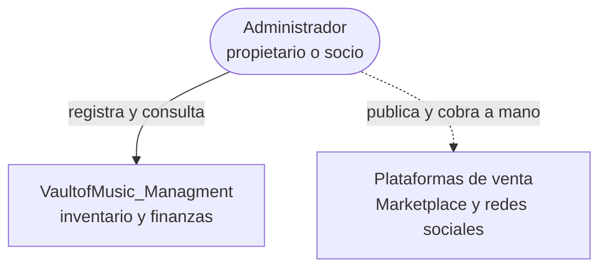
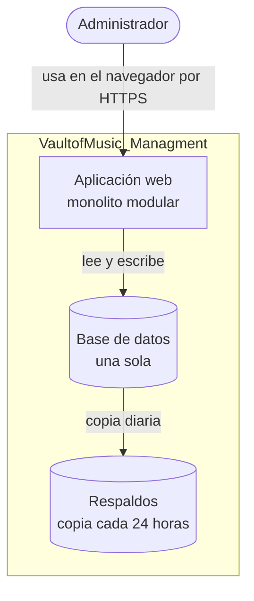
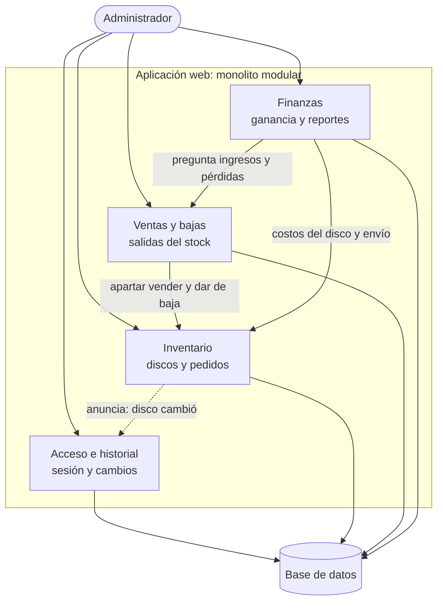
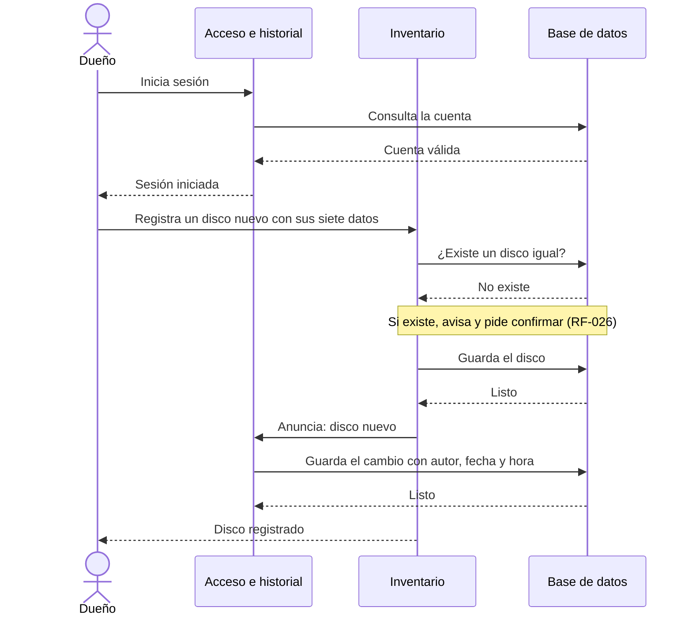

# Diagramas de arquitectura: VaultofMusic_Managment

Diagramas en Mermaid (texto), según la Guía rápida de Mermaid de la Unidad 3. Se ven renderizados directo en GitHub o pegando cada bloque en https://mermaid.live.

## 1. Contexto (C4 nivel 1)

Quién usa el sistema y con qué se relaciona. Solo existe un tipo de usuario (el propietario o su socio). Las plataformas de venta no se integran: se publica y se cobra a mano.

## 2. Contenedores (C4 nivel 2)

Qué se instala y dónde. Es software instalado en un dominio propio: una aplicación web (monolito modular), una sola base de datos y un respaldo cada 24 horas.

## 3. Componentes (C4 nivel 3)

Los cuatro módulos dentro del monolito. Las flechas sólidas son dependencias de una sola vía; Inventario no depende de nadie. La flecha punteada es el aviso del patrón Observer: Inventario anuncia que un disco cambió y Acceso e historial lo registra.

## 4. Caso: el dueño inicia sesión y registra un disco nuevo

